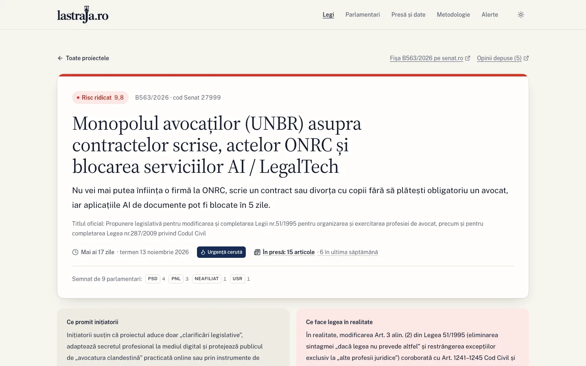
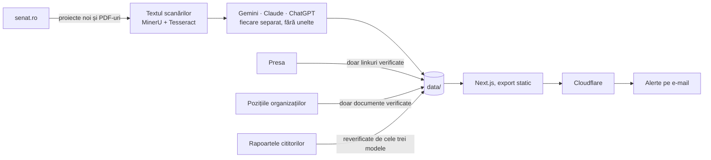

<p align="center">
  <a href="https://destraja.ro">
    <picture>
      <source media="(prefers-color-scheme: dark)" srcset=".github/readme/logo-dark.svg">
      
    </picture>
  </a>
</p>

<p align="center">
  <b>Stăm de strajă. Să știi ce se pregătește.</b><br>
  Proiectele aflate în consultare la Senat, ce înseamnă pentru tine și cum trimiți o obiecție oficială. Pe înțelesul tuturor.
</p>

<p align="center">
  <a href="https://destraja.ro"><b>destrajă.ro</b></a> ·
  <a href="https://destraja.ro/metodologie">Metodologie</a> ·
  <a href="https://destraja.ro/presa">Camera de presă</a> ·
  <a href="#licență">Licență</a> ·
  <a href="#in-english">English</a>
</p>

<picture>
  <source media="(prefers-color-scheme: dark)" srcset=".github/readme/home-dark.webp">
  
</picture>

## Ce este

**destrajă.ro** (până pe 28 octombrie 2026, lastraja.ro) urmărește fiecare proiect de lege aflat în consultare publică la
[Senatul României](https://www.senat.ro/LegiProiect.aspx). Trei modele AI, Gemini, Claude și ChatGPT, citesc separat
textul oficial. Site-ul traduce fiecare proiect într-o propoziție, îi dă un scor de risc și te ajută să trimiți o opinie
oficială la Senat înainte să expire termenul.

Proiect civic independent: nu reprezentăm Senatul și nu lucrăm pentru niciun partid.

## Ce găsești pe site

- **O propoziție pe înțeles** pentru fiecare proiect: ce schimbă pentru tine, nu doar ce scrie în titlul oficial.
- **Trei lecturi AI, separate.** Scorul fiecărui model e la vedere, la fel și locurile în care nu sunt de acord.
  Afirmațiile inițiatorilor sunt verificate față de text.
- **Kitul de obiecție în 60 de secunde:** textele gata dimensionate pentru formularul Senatului (50 și 400 de
  caractere) și un memoriu .docx, completat cu numele tău direct în browser.
- **Semnale:** procedura de urgență, avizele negative ale Consiliului Economic și Social (cu motivele, citate din aviz)
  și proiectele semnate împreună de putere și opoziție.
- **Presa:** doar articole verificate, care există și citează proiectul, cu poziția lor față de proiect (critic,
  favorabil, neutru, mixt) acolo unde cel puțin doi din trei cititori sunt de acord.
- **Ce spun organizațiile:** scrisorile, petițiile și punctele de vedere ale ONG-urilor, sindicatelor, patronatelor și
  organizațiilor profesionale, cu semnatarii numărați din document.
- **Parlamentarii:** proiectele fiecăruia și datele de contact oficiale de pe cdep.ro și senat.ro.
- **Alerte pe e-mail** în zilele lucrătoare, doar când apare ceva nou.
- **Camera de presă:** rezumat, titluri verificabile, harta coalițiilor și export CSV.

<picture>
  <source media="(prefers-color-scheme: dark)" srcset=".github/readme/bill-dark.webp">
  
</picture>

### Punctul de vedere scris cu Claude Code

Skill-ul [`punct-de-vedere`](.claude/skills/punct-de-vedere/SKILL.md) scrie cu tine punctul de vedere: citește analiza
proiectului, te întreabă cine ești și cum te atinge legea, apoi pune e-mailul ca ciornă, cu memoriul .docx atașat, ca
să-l trimiți tu. Dă și textele pentru formularul Senatului, numărate la limitele lui. Pornește `claude` în clona
repo-ului și scrie `/punct-de-vedere https://destraja.ro/legi/b563-2026`. Ca să-l folosești din orice folder, copiază
`.claude/skills/punct-de-vedere/` în `~/.claude/skills/`.

Întrebările vin din skill-ul [`grilling`](https://github.com/mattpocock/skills/tree/main/skills/productivity/grilling) al lui Matt Pocock: câte o rundă, cu un
răspuns propus la fiecare întrebare. Un punct de vedere cântărește când arată un caz real, pe care inițiatorii nu l-au
văzut, iar întrebările scot acel caz la iveală. Instalează-l cu `claude plugins install mattpocock-skills`; fără el,
skill-ul folosește o copie (licență MIT) din `references/`.

## Cum funcționează

În fiecare zi lucrătoare la 08:00 rulează `npm run straja:daily`:



1. **Senatul** (`scripts/straja-sync.mjs`): proiectele noi, PDF-urile lor și textul. PDF-urile Senatului sunt scanări,
   așa că le citim cu [MinerU](https://github.com/opendatalab/MinerU) 4, local, care păstrează titlurile și tabelele, și
   verificăm fiecare pagină cu Tesseract în română. O pagină pe care MinerU o repetă în buclă sau din care pierde text
   vine de la Tesseract (`scripts/lib/pdf-text.mjs`).
2. **Analiza** (`straja-council.mjs`): fiecare model citește proiectul separat și dă un scor de la 1 la 10. Publicăm
   consensul și scorul fiecăruia. Apoi `straja-ces.mjs` rezumă motivele avizelor negative CES.
3. **Presa** (`straja-news.mjs`): caută articole despre proiectele aflate în consultare și păstrează doar linkurile care
   se încarcă și conțin citatul dat de model. Apoi `straja-stance.mjs` dă textul fiecărui articol, curățat cu
   trafilatura, la trei cititori: două modele de decizie open source rulate pe Mac, Clef (Cloudflare) și d1-3B (Liquid
   AI), plus GPT-6 Luna prin Codex. Răspund la patru întrebări fixe: poziția față de proiect, tipul sursei, dacă e chiar
   despre proiect și dacă e un comunicat de partid. Pe site punem eticheta doar unde cel puțin doi sunt de acord (detalii
   în [`scripts/local-models`](scripts/local-models/README.md)).
4. **Pozițiile organizațiilor** (`straja-positions.mjs`): caută scrisori deschise, petiții, solicitări și puncte de vedere,
   inclusiv pe site-urile emitenților. O poziție apare doar dacă pagina sau PDF-ul se deschide, pomenește proiectul și
   conține citatul; lista semnatarilor e numărată din document, cu numerotarea verificată. Proiectele cu risc ridicat
   sau aproape de termen sunt verificate zilnic, cele cu risc moderat la 3 zile, restul o dată pe săptămână, cel mult 16
   pe zi.
5. **Parlamentarii** (`straja-mps.mjs`): datele de contact de pe fișele oficiale, o cerere pe secundă.
6. **Rapoartele cititorilor** (`straja-reports.mjs`): o greșeală semnalată pe site e reverificată de cele trei modele față
   de textul oficial.
7. **Memoriile .docx** (`straja-docx.mjs`), apoi verificări, build, publicare pe Cloudflare și ediția zilnică a alertelor
   (`straja-digest.mjs`).

Rezultatele intră în `data/`, cu tot istoricul lor în git.

## De ce poți avea încredere

- **Totul e public:** codul, prompturile, răspunsurile modelelor și datele. Poți vedea exact ce a primit fiecare model
  și ce a răspuns.
- **Modelele nu au unelte când citesc proiectele și rapoartele.** Primesc textul în prompt și răspund cu JSON; nu pot
  naviga, rula comenzi sau scrie fișiere. Doar căutarea în presă și cea a pozițiilor organizațiilor folosesc căutare
  web, tot fără terminal și fără fișiere.
- **Citatele se verifică în cod.** Un motiv dintr-un aviz CES apare doar dacă citatul lui e găsit literal în aviz. O
  poziție a unei organizații apare doar dacă documentul pomenește proiectul și conține citatul; semnatarii sunt
  numărați din listă, nu luați de la model.
- **Corecturile au reguli.** O greșeală raportată corectează analiza doar dacă toate trei modelele o confirmă cu citate
  verificate, iar corectura apare pe pagină, cu data. Restul rapoartelor ajung la un om.
- **Fără conturi și fără reclame.** Statisticile pornesc doar după ce accepți.

## Pornește site-ul local

Ai nevoie doar de Node.js 20 sau mai nou. Datele sunt deja în `data/`, deci nu-ți trebuie abonamente AI.

```bash
git clone https://github.com/eek/destraja.ro.git
cd destraja.ro
npm install
npm run dev       # http://localhost:3000
```

| Comandă | Ce face |
|---|---|
| `npm run dev` | site-ul în modul de dezvoltare |
| `npm run build` | exportul static în `out/` |
| `npm run preview` | build plus Worker-ul și D1 local, ca pe Cloudflare (`wrangler dev`) |
| `npm run deploy` | migrațiile D1, build și publicarea pe destraja.ro (doar pentru întreținător) |

## Structura

| Folder | Ce e |
|---|---|
| `src/app/` | paginile (Next.js, export static) |
| `src/components/` | componentele; satul 3D (three.js) e în `home/sat/` |
| `src/lib/` | citirea datelor, calculele pentru grafice, exportul, Google Analytics |
| `worker/` | Worker-ul Cloudflare: rapoarte, abonări, confirmări, preferințe, alerte |
| `migrations/` | schema bazei D1 |
| `scripts/` | lanțul zilnic: Senat, OCR, modele, presă, parlamentari, alerte |
| `.agents/` | agenții Gemini: unul fără unelte, unul doar cu căutare web |
| `email/` | șablonul e-mailurilor |
| `data/` | datele publicate |
| `public/docs/` | memoriile .docx |

## Pentru întreținere

### Lanțul zilnic

`npm run straja:daily` rulează luni–vineri la 08:00 prin launchd (`scripts/install-daily.sh`; `--remove` îl oprește).
Are nevoie de:
- CLI-urile `agy` (Gemini), `claude` și `codex`, autentificate (implicit în `~/.local/bin`, sau căile din `AGY_BIN`,
  `CLAUDE_BIN`, `CODEX_BIN`);
- OCR-ul: `brew install uv tesseract ocrmypdf`, apoi `sh scripts/install-ocr.sh`. Scriptul pune MinerU 4 într-un venv
  Python 3.12 în `~/.local/share/lastraja-ocr` (cu modelele, ~3 GB pe disc; o rulare ține 4–9 GB de RAM) și copiază
  acolo limbile Tesseract `ron`, `eng` și `osd`, ca un `brew upgrade` să nu strice româna. Fără MinerU textele se citesc
  doar cu Tesseract, iar fără ocrmypdf rămâne stratul de text al PDF-ului;
- un token Cloudflare în `.env`.

La final face commit cu datele zilei și push pe GitHub, după ce preia ce s-a aprobat între timp prin PR. Jurnalul e în
`ops/logs/`, iar la final apare o notificare macOS. Un pas care eșuează nu oprește restul, cu excepția
verificării datelor: fără date valide nu publicăm. Dacă semnarea commit-urilor cere 1Password deblocat, datele zilei rămân
necomise până la următorul commit.

Fiecare pas merge și separat: `npm run straja:sync`, `straja:council <slug>`, `straja:news`, `straja:stance`,
`straja:positions`, `straja:mps`, `straja:reports`, `straja:docx`, `straja:digest`. `--skip-news`, `--skip-positions` și
`--skip-mps` sar peste pașii respectivi în rularea zilnică. Textele PDF-urilor se refac cu
`node scripts/straja-texts.mjs --force [slug]`; rezultatele OCR rămân în `.cache/ocr`, așa că o refacere după o schimbare
de cod durează secunde, iar o recitire completă (`--fresh`) durează 1,5–2 ore.

### Date

- `data/senat-bills.json`: proiectele preluate de pe senat.ro.
- `data/analyses/*.json`: analizele celor trei modele, cu consensul.
- `data/texts/<slug>/`: textul fiecărui PDF, în Markdown (`.md`, afișat pe pagina proiectului, cu titluri și tabele) și
  ca text simplu (`.txt`, pentru modele și pentru verificarea citatelor). `_meta.json` spune cum a fost citit:
  `mineru`, `mineru+ocr` (unele pagini de la Tesseract), `ocr` (doar Tesseract) sau `text` (stratul PDF-ului).
- `data/ces/`, `data/news/`, `data/mp-contacts.json`: avizele CES, presa verificată, contactele parlamentarilor.
- `data/positions/<slug>.json`: pozițiile organizațiilor. `positions` sunt cele verificate (pe site): emitentul, poziția
  (`retragere`, `respingere`, `modificare`, `sustinere`), citatul, data, pagina și documentul, semnatarii numărați din
  document (doar organizațiile cu nume) și ziua verificării. `pending` sunt propunerile care au picat o verificare, cu
  motivul, doar pentru tine. O poziție găsită altfel se adaugă cu
  `npm run straja:positions -- <slug> --add --issuer=… --stance=… --quote=… --page=… --doc=…` și trece prin aceeași
  verificare; `--recheck` le reverifică pe cele salvate, fără modele.
- `data/citizen-one-liners.json`: propoziția pe înțelesul tuturor, scrisă pentru proiectele de la lansare. Un proiect
  nou fără intrare aici afișează rezumatul modelelor (`summaryTlDr`).
- `src/lib/site.ts`: proiectul pus în față, împărțirea putere/opoziție (de revizuit când se schimbă coaliția), datele
  operatorului și cheile publice.

### Rapoarte de erori

`worker/index.ts` primește raportul pe `POST /api/report`, îl verifică cu Turnstile (`TURNSTILE_SECRET`, pus cu
`wrangler secret put`) și îl salvează în D1, fără IP și fără e-mail. `npm run straja:reports` le verifică: cele trei
modele, fără unelte, compară raportul cu textul oficial. Analiza se corectează singură doar dacă toate trei confirmă
greșeala cu citate găsite literal în analiză și în textul oficial, iar corectura propusă de Claude e aprobată de
celelalte două. Textul raportului nu ajunge niciodată la modelul care scrie corectura. Restul ajunge în
`ops/digest/AAAA-LL-ZZ.md`, de decis manual.

### Alerte pe e-mail

Vizitatorii aleg un nivel (`all`: tot, cu rezumat; `yellow`: risc mediu și ridicat; `red`: doar risc ridicat) și confirmă
adresa din e-mail. `worker/subscribe.ts` trimite confirmarea prin Cloudflare Email Service (doar de la
`alerte@destraja.ro`) și ține abonații în D1. Linkurile de preferințe și dezabonare sunt semnate cu `SUBSCRIBE_KEY`;
dezabonarea dintr-un click (`List-Unsubscribe`) șterge adresa.

`npm run straja:digest` scrie ediția zilei în `ops/digest/` (previzualizare). Cu `--send` o trimite prin Worker
(`POST /api/digest`, cu `DIGEST_TOKEN`) și actualizează `data/digests/state.json`, evidența a ce au primit deja abonații.
Un nivel primește e-mail doar dacă are ceva nou. Adresele nu ajung pe calculatorul care rulează scriptul.

### Statistici

Google Analytics pornește doar după acordul vizitatorului. Un link sau un buton nou se măsoară cu
`{...trackAttrs('nume_eveniment', { bill_id })}` (lista evenimentelor e în `src/lib/analytics.ts`); nu trimitem
niciodată texte scrise de vizitator.

### Local, cu Worker

`npm run preview` folosește cheile de test Turnstile și secretele din `.dev.vars` (ignorat de git) și o bază D1 locală
(`npx wrangler d1 migrations apply lastraja --local`). E-mailurile nu pleacă: wrangler le scrie în
`.wrangler/tmp/email/`.

## Contribuie

Greșelile de afișare, textele, accesibilitatea și codul se repară prin pull request; vezi [CONTRIBUTING.md](CONTRIBUTING.md).
O greșeală într-o analiză se semnalează de pe pagina proiectului, nu prin PR. Problemele de securitate se trimit
privat; vezi [SECURITY.md](SECURITY.md).

## Licență

- **Codul:** [AGPL-3.0](LICENSE). Dacă rulezi o versiune modificată pe un site, publică și tu modificările.
- **Analizele și datele:** [CC BY 4.0](LICENSE-DATA.md). Le poți prelua și adapta, inclusiv în scop comercial, dacă
  citezi sursa: online, cu link la pagina proiectului pe destrajă.ro; în tipar, la radio sau la TV, „potrivit
  destrajă.ro”. Textele oficiale, citatele de presă, datele de contact ale parlamentarilor și logoul nu intră în
  licență; detalii în [LICENSE-DATA.md](LICENSE-DATA.md).
- **OCR:** textul documentelor scanate e recunoscut cu [MinerU](https://github.com/opendatalab/MinerU) (OpenDataLab,
  MinerU Open Source License, bazată pe Apache-2.0; modelul MinerU2.5-Pro, Apache-2.0) și verificat cu
  [Tesseract](https://github.com/tesseract-ocr/tesseract) (Apache-2.0).

## In English

**destrajă.ro** ("on guard", from *a sta de strajă*) is an independent civic watch over every bill in public consultation at the
Romanian Senate. Three AI models (Gemini, Claude and ChatGPT) read each official text separately. The site turns each
bill into one plain sentence and a risk score, shows where the models disagree, and helps citizens file an official
opinion before the deadline. The Senate's PDFs are scans: their text is recognised locally with MinerU (OpenDataLab)
and checked page by page with Tesseract. Built with Next.js (static export) on Cloudflare; the daily pipeline runs on the
maintainer's Mac. Code: AGPL-3.0. Analyses and data: CC BY 4.0. Please credit "destrajă.ro" and link
to the bill page.
